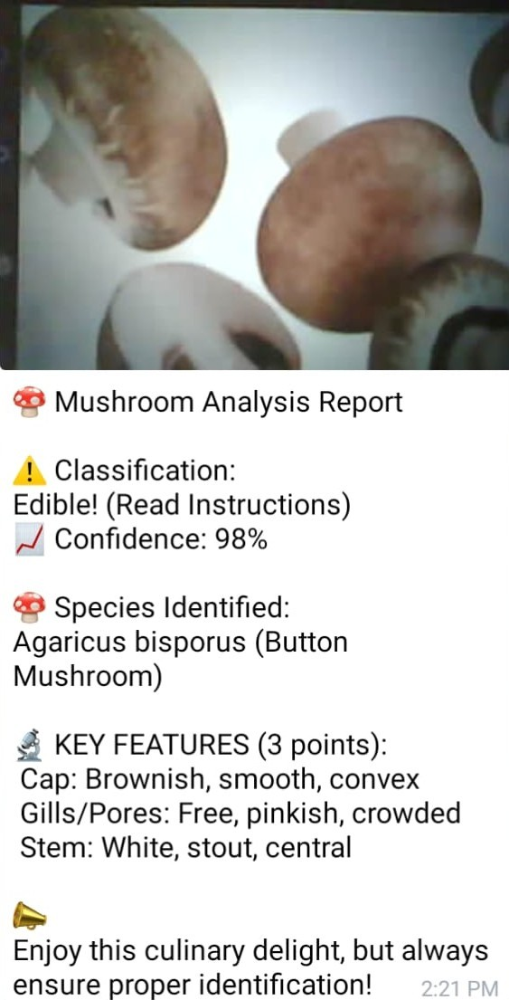
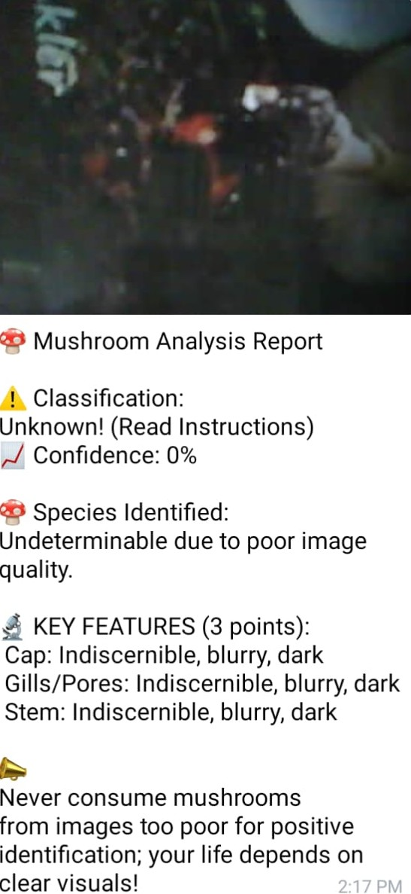
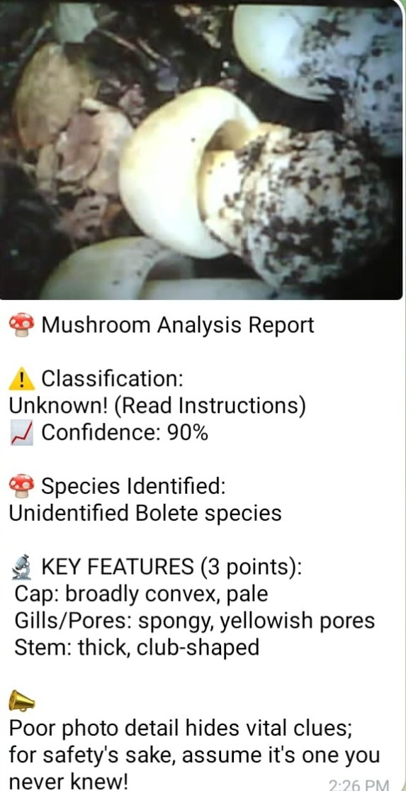

# MushX: AI-Based Mushroom Condition Detection System

> An ESP32-CAM system that captures a mushroom image and sends it to Gemini's
> vision model, grounded with a mushroom knowledge base (RAG), and replies with
> a safety-first analysis through a Telegram bot.

<table>
  <tr>
    <td></td>
    <td></td>
    <td></td>
  </tr>
  <tr>
    <td align="center">Clear image: species identified</td>
    <td align="center">Poor image: refuses to guess</td>
    <td align="center">Uncertain: marked Unknown</td>
  </tr>
</table>


## Problem
Wild and cultivated mushrooms can look alike, and some are poisonous.
Identifying them usually needs an expert, and a wrong guess can be dangerous.

## Solution
MushX gives a quick, low-cost first check. A camera captures the mushroom,
a pretrained vision model analyzes it, and a knowledge base keeps the answer
grounded. The system is designed to say "Unknown" rather than guess.

## Features
- Image capture using ESP32-CAM
- Classification as Edible, Poisonous, or Unknown, with a confidence score
- Species identification and 3 key visual features (cap, gills/pores, stem)
- RAG grounding against a mushroom knowledge base to reduce hallucinations
- Safety-first behavior: poor or unclear images return Unknown with a warning
- Results delivered through a Telegram bot
  

## Safety-First Design
- A dark or blurry image returns **Unknown, 0% confidence** instead of a guess.
- An uncertain species, such as an unidentified bolete, is marked **Unknown** even when the visual description is confident, so the system errs on the side of caution.
- Every report ends with a reminder not to eat a mushroom based on this output alone.

## How It Works
1. The ESP32-CAM captures an image and streams it to the server
2. The image is sent to Gemini's pretrained vision API
3. The response is grounded against the mushroom knowledge base (RAG)
4. The result (classification, confidence, species, key features) is formatted
5. The Telegram bot sends the report with the image to the user

## Why a Pretrained Model
Gemini vision with RAG grounding avoids the data collection and training cost
of a custom model, while the knowledge base keeps classifications reliable.

## Hardware
| Component | Purpose |
|-----------|---------|
| ESP32-CAM | Image capture and streaming |
| [Sensors, if any] | [Purpose] |

## Tech Stack
Python, Gemini API, RAG ([vector database]), ESP32-CAM, Telegram Bot API

## Project Structure
```
mushx_ccp/
├── main.py                  # entry point
├── camera_stream_server.py  # receives the ESP32-CAM stream
├── camera_utils.py          # image capture and handling
├── gemini_analyzer.py       # Gemini vision analysis
├── sensor_utils.py          # [sensor handling]
├── telegram_bot.py          # Telegram bot interface
├── images/                  # screenshots
└── requirements.txt
```

## Results
| Metric | Result |
|--------|--------|
| Classification accuracy | 93% on 50 test images |
| Average response time | 6 s from capture to Telegram report |

## Setup
```bash
git clone https://github.com/joysan16/mushx-mushroom-detection.git
cd mushx-mushroom-detection
pip install -r requirements.txt
cp .env.example .env    # add GEMINI_API_KEY and TELEGRAM_BOT_TOKEN
python main.py
```

## Disclaimer
MushX is a research and learning project. **Never eat a mushroom based on this
system's output.** Always confirm with a qualified expert.

## Research
Co-authored a technical paper on AI-driven food safety solutions at
NIT Trichy.

## Author
**R. Joy Sandhiya**, ECE, Chennai Institute of Technology
https://www.linkedin.com/in/joy-san16 | joysandhiyar@gmail.com
